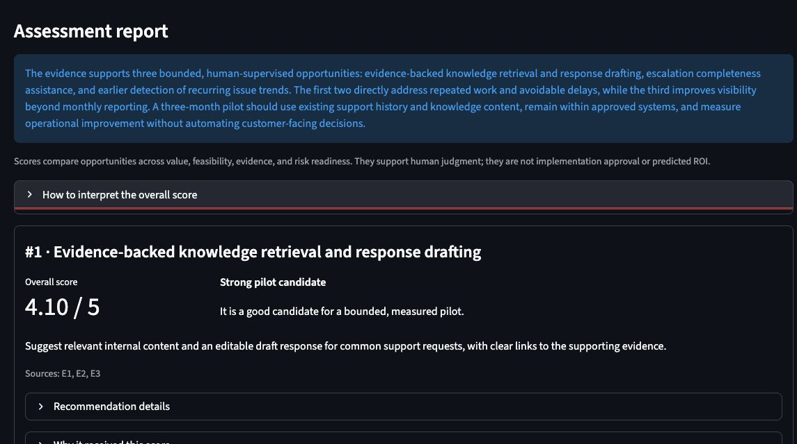

# AI Product Discovery Platform

[](https://github.com/scott-deforest/ai-product-discovery-platform/actions/workflows/tests.yml)

A local assessment application that turns product, process, and workflow
documentation into evidence-grounded, reviewable AI opportunities.

The platform is designed to help a product leader answer:

> Where could AI create measurable value in this workflow, what evidence supports
> that conclusion, and what should we validate before investing?



## Project status

**Employer-preview MVP — Sprint 2 complete; Sprint 3 evaluation work in progress.**

The end-to-end workflow is functional: documents can be ingested, searched, used
to generate structured opportunities, scored with a transparent rubric, and
reopened as saved reports. The application is intentionally local and
single-user. It is a portfolio demonstration, not a production SaaS product.

## What it demonstrates

- Product framing around a real decision workflow rather than a generic chatbot.
- Evidence-grounded generation with source citations and explicit uncertainty.
- Structured OpenAI responses validated through Pydantic before persistence.
- Assessment-scoped retrieval that prevents evidence crossing between projects.
- Transparent, deterministic scoring instead of an unexplained model ranking.
- Human-review safeguards, plain-language errors, and technical operational logs.
- Migration-safe SQLite persistence and automated tests that do not spend API
  credits.

## User workflow

1. Create a named assessment with business context.
2. Upload PDF, TXT, Markdown, or DOCX source material.
3. Extract, inspect, chunk, and index the text.
4. Preview evidence retrieved across four assessment dimensions.
5. Run the AI assessment using only the displayed evidence.
6. Review ranked opportunities, score rationales, risks, safeguards, evidence
   gaps, success measures, and exact source excerpts.
7. Reopen any saved report without making another OpenAI request.

See the [sample assessment report](docs/SAMPLE_REPORT.md) for a compact example.

## Architecture

```text
Streamlit interface
       |
       +-- SQLite -------- assessments, source metadata, runs, ranked reports
       |
       +-- Local files --- uploads and extracted text
       |
       +-- Chroma -------- assessment-scoped vectors and similarity search
       |
       +-- OpenAI API ---- embeddings and validated structured analysis
```

One Chroma collection stores all document chunks. Each vector carries an
`assessment_id`, `document_id`, filename, and chunk index. Every retrieval is
filtered by `assessment_id`.

The analysis workflow creates stable evidence identifiers such as `E1` and `E2`.
The model can reference those identifiers, but the application—not the model—
attaches the trusted filename, chunk ID, and source excerpt. Unknown citations
are rejected before results are saved.

## Assessment framework

Evidence is retrieved across four lenses:

- Workflow pain points
- Data and technical readiness
- Business value
- Risk and human oversight

Each opportunity receives four 1–5 component scores. Application code applies the
published weighting and ranks the candidates deterministically:

| Component | Weight |
| --- | ---: |
| Business value | 35% |
| Feasibility | 25% |
| Evidence strength | 25% |
| Risk readiness | 15% |

The interface translates the composite into a decision band from **Weak
candidate** through **High-priority validation candidate**. Scores are comparison
aids—not predicted ROI, confidence percentages, or implementation approval.

## Local setup

Python 3.9 or newer is required.

```bash
git clone https://github.com/scott-deforest/ai-product-discovery-platform.git
cd ai-product-discovery-platform
python3 -m venv .venv
source .venv/bin/activate
python -m pip install --upgrade pip
python -m pip install -r requirements.txt
cp .env.example .env
```

Add your OpenAI API key to `.env`:

```text
OPENAI_API_KEY=your_key_here
OPENAI_EMBEDDING_MODEL=text-embedding-3-small
OPENAI_ANALYSIS_MODEL=gpt-5.6-sol
```

Never commit `.env` or share an API key.

## Run the application

```bash
python -m streamlit run app.py
```

Open `http://localhost:8501` if the browser does not open automatically.

## Demo workflow

1. Create an assessment named **Customer Support Workflow**.
2. Upload `data/sample_docs/customer_support_workflow.md`.
3. Extract the text, create chunks, and index them.
4. Preview the assessment evidence.
5. Select **Run and save assessment**.
6. Review the ranked opportunities and expand their score explanations and
   source evidence.
7. Refresh the page and reopen the report to demonstrate local persistence.

The model response can vary between runs. Source-grounding and validation rules
remain consistent.

## Tests

```bash
python -m unittest discover -s tests -v
```

The test suite covers persistence, extraction, chunking, vector filtering,
readiness rules, evidence deduplication, structured generation, citation
validation, failure recovery, deterministic ranking, score interpretation, and
saved-report reconstruction. Model and embedding clients are faked in automated
tests, so the suite does not require an API key or spend API credits.

GitHub Actions runs the same suite on every push and pull request.

## Project structure

```text
app.py                         Streamlit interface and report review
src/assessment_runner.py       Readiness, evidence, generation, and run lifecycle
src/chunking.py                Deterministic overlapping chunks
src/config.py                  Local paths and model configuration
src/database.py                SQLite persistence and report reconstruction
src/ingestion.py               Upload storage and text extraction
src/models.py                  Validated Pydantic domain models
src/prompts/                   Versioned analysis prompts
src/reporting.py               Deterministic scoring and interpretation
src/vector_store.py            Embeddings, Chroma, and scoped retrieval
data/sample_docs/              Safe demo documents
docs/                          Sprint plan, screenshots, and sample output
tests/                         Offline automated tests
```

## Data handling

- API keys, uploaded files, extracted text, SQLite data, and vectors are excluded
  from Git.
- Uploaded files and persisted reports remain on the local machine.
- Document chunks and search queries are sent to OpenAI to create embeddings.
- The displayed evidence pack is sent to OpenAI when the user runs an assessment.
- Generated recommendations require citations and retain human review as the
  decision boundary.

Do not use sensitive or regulated documents without confirming that the selected
API account, retention settings, and organizational policies permit that use.

## Current limitations

- Local, single-user application with no authentication or access controls.
- No OCR for scanned PDFs.
- No duplicate-upload management or document deletion interface yet.
- The retrieval and assessment model configuration is developer-managed.
- Scores depend on source quality and model judgment even though weighting and
  ranking are deterministic.
- No production monitoring, evaluation dataset, or deployment configuration.

## Roadmap

Sprint 3 will add complexity only where it improves the decision. The first
increment introduces automatic report checks, a five-part human-review rubric,
and multiple benchmark workflows. Later increments will add explicit human review
actions and role-specialized analysis, then compare that candidate pipeline with
the simpler Sprint 2 baseline. See the [Sprint 3 design](docs/SPRINT_3.md) and the
[Sprint 2 design](docs/SPRINT_2.md).

## License

Copyright © 2026 Scott DeForest. All rights reserved.

The source is available for portfolio evaluation and demonstration. No license
for reuse, modification, or distribution is granted. See the full
[copyright notice](COPYRIGHT.md).
